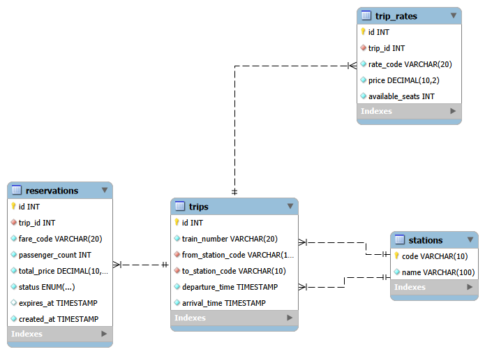

# ЖД-Дроп - сервис бронирования железнодорожных билетов

Backend-сервис по тестовому заданию: поиск прямых поездов по станциям, дате и числу
пассажиров, временная бронь мест по выбранному тарифу, подтверждение, отмена и
автоматическое истечение брони.

## Стек

* Java 21, Spring Boot 4.1, Maven
* PostgreSQL 16, Spring Data JPA, Liquibase
* JUnit 5, Mockito, Testcontainers (PostgreSQL и Kafka в контейнерах)
* Docker Compose

Kafka используется для публикации события `TicketConfirmed` после успешной покупки
(пункт «Дополнительно»). Публикация необязательна: без брокера бронь и подтверждение
работают как обычно - ошибка отправки только пишется в лог.
Сервис Kafka в `docker-compose.yml` спрятан за профиль `kafka`.

## Запуск

### Через Docker Compose

Нужны Docker и файл `.env` рядом с `docker-compose.yml`:

```bash
docker compose up --build
```

Приложение: `http://localhost:8080`, Swagger UI: `http://localhost:8080/swagger-ui.html`.

### Локально без Docker

Нужна PostgreSQL с базой `zhddrop` на `localhost:5432`:

```bash
export POSTGRES_USERNAME=zhddrop
export POSTGRES_PASSWORD=change_me
./mvnw spring-boot:run
```

Схема и демо-данные накатываются Liquibase при старте.

### Тесты

Юнит-тесты (без Docker, выполняются по умолчанию):

```bash
./mvnw test
```

Интеграционные тесты на Testcontainers поднимают PostgreSQL 16 и Kafka (KRaft) в
контейнерах, прогоняют миграции Liquibase и проверяют весь сценарий через HTTP
\+ чтение события из Kafka. Нужен запущенный Docker:

```bash
./mvnw test -Pintegration
```

`*IT`-классы помечены тегом `integration` и исключены из обычной сборки, поэтому
`./mvnw test` не требует Docker.

## Модель данных

| Таблица | Назначение |
|---|---|
| `stations` | справочник станций (`MSK`, `SPB`, `NSK`) |
| `trips` | поезд: номер, станции отправления/прибытия, время |
| `trip_rates` | тариф поезда (`PROMO`, `STANDARD`), цена и свободные места |
| `reservations` | бронь: поезд, тариф, число пассажиров, зафиксированная цена, статус, `created_at`, `expires_at` |

Демо-данные: три поезда Москва -> Санкт-Петербург, у поезда 101 тариф «Промо» всего на
2 места (удобно проверять нехватку мест), «Стандарт» - на 50. Даты отправления
сдвигаются относительно текущей даты миграцией, поэтому поиск не «стареет».

## Статусы брони

| Статус | Смысл |
|---|---|
| `HELD` | места списаны, бронь ждёт подтверждения до `expires_at` |
| `CONFIRMED` | покупка совершена, места остаются занятыми |
| `CANCELLED` | отменена клиентом, места возвращены в остаток |
| `EXPIRED` | не подтверждена вовремя, места возвращены планировщиком |

Срок удержания задаётся в одном месте - `reservation.hold.ttl` (по умолчанию 15 минут).
Планировщик раз в минуту закрывает просроченные `HELD`; операция идемпотентна.

Также сделал общую схему БД в MySqlWorkbench



## API

### Поиск поездов

```http
GET /api/trips/search?from=MSK&to=SPB&date=2026-11-20&passengers=2
```

* `from` / `to` - код станции (`MSK`, `msk`) или название города (`Москва`);
* `passengers` - от 1 до 10, по умолчанию 1;
* возвращаются только будущие поезда, у которых есть тариф с достаточным числом мест;
  сами тарифы без мест отфильтрованы;
* сортировка: сначала минимальная сумма за всех пассажиров, затем время отправления.

```json
[
  {
    "trainNumber": "002A",
    "departureTime": "2026-11-20T08:00:00Z",
    "arrivalTime": "2026-11-20T12:00:00Z",
    "rates": [
      { "fareCode": "PROMO", "price": 1500.00, "availableSeats": 2 },
      { "fareCode": "STANDARD", "price": 3500.00, "availableSeats": 50 }
    ]
  }
]
```

### Создание брони

```http
POST /api/reservations
Content-Type: application/json

{ "tripId": 101, "fareCode": "PROMO", "passengerCount": 2 }
```

Ответ `201 Created`, заголовок `Location: /api/reservations/{id}`:

```json
{
  "id": 1,
  "tripId": 101,
  "trainNumber": "002A",
  "fareCode": "PROMO",
  "passengerCount": 2,
  "totalPrice": 3000.00,
  "status": "HELD",
  "createdAt": "2026-11-13T10:00:00Z",
  "expiresAt": "2026-11-13T10:15:00Z"
}
```

`totalPrice` - цена на момент оформления; изменение тарифа позже её не пересчитывает.

### Остальные операции

```http
GET /api/reservations/{id}
PUT /api/reservations/{id}/confirm
PUT /api/reservations/{id}/cancel
```

Подтвердить и отменить можно только бронь в статусе `HELD`. Подтверждение просроченной
брони возвращает `409 RESERVATION_EXPIRED`, переводит её в `EXPIRED` и возвращает места.

## Ошибки

Единый формат для всех ответов:

```json
{
  "timestamp": "2026-11-13T10:00:00Z",
  "status": 409,
  "code": "SEATS_NOT_AVAILABLE",
  "message": "Not enough seats for fare PROMO on trip 101",
  "details": []
}
```

| HTTP | `code` | Когда возникает |
|---|---|---|
| 400 | `VALIDATION_FAILED` | `passengerCount < 1` или `> 10`, пустой `from`, нет `tripId` |
| 400 | `MALFORMED_REQUEST_BODY` | битый JSON, неизвестный `fareCode` |
| 400 | `INVALID_PARAMETER` | `date=2026-13-45`, `id=abc` |
| 400 | `UNKNOWN_STATION` / `INVALID_STATION` | неизвестная станция |
| 404 | `TRIP_NOT_FOUND`, `FARE_NOT_FOUND`, `RESERVATION_NOT_FOUND` | объекта нет |
| 409 | `SEATS_NOT_AVAILABLE` | мест не хватает на момент списания |
| 409 | `TRIP_ALREADY_DEPARTED` | поезд уже отправился |
| 409 | `RESERVATION_EXPIRED` | подтверждение просроченной брони |
| 409 | `RESERVATION_NOT_HELD` | повторное подтверждение/отмена |
| 500 | `INTERNAL_ERROR` | непредвиденная ошибка, детали только в логах |

## Kafka: событие TicketConfirmed

После подтверждения брони в топик `ticket-confirmed` уходит JSON-событие с ключом
`reservationId`:

```json
{
  "reservationId": 5,
  "tripId": 103,
  "trainNumber": "002B",
  "fareCode": "PROMO",
  "passengerCount": 1,
  "totalPrice": 1500.00,
  "confirmedAt": "2026-11-13T10:05:00Z"
}
```

Решения по интеграции:

* событие публикует `@TransactionalEventListener(phase = AFTER_COMMIT)`: потребитель не должен узнать о покупке, которая может откатиться;
* отправка асинхронная, ошибки логируются и не влияют на ответ API - покупка уже
  зафиксирована в БД (`spring.kafka.producer.properties.max.block.ms=2000`, чтобы
  недоступный брокер не задерживал запрос);
* отключение - `app.kafka.enabled=false`, имя топика - `app.kafka.topic`;
* `groupId` у приложения нет: оно только публикует, потребитель - внешняя система.

```bash
docker compose --profile kafka up -d      # локальный брокер на localhost:9092
```

Формат ошибок и переходы статусов не меняются: событие - побочный эффект успешной
покупки, а не её условие.

## Принятые решения

### Доступность мест и параллельные запросы

Списание мест - один условный запрос:

```sql
UPDATE trip_rates SET available_seats = available_seats - :seats
WHERE trip_id = :tripId AND rate_code = :rateCode AND available_seats >= :seats
```

Если строк не обновилось - мест не хватило, и транзакция завершается `409`, остатки не
меняются. Такой подход выбран вместо `SELECT ... FOR UPDATE`: он короче, не держит
блокировку на время чтения и не даёт уйти в минус даже при параллельных бронированиях.
Ограничение `CHECK (available_seats >= 0)` в БД дублирует гарантию на уровне схемы.

Списание и вставка брони идут в одной транзакции: если вставка не пройдёт, места
откатятся вместе с ней (`saveAndFlush` нужен, чтобы ошибка возникла внутри транзакции,
а не при коммите, и чтобы в ответе был `id`).

### Подтверждение, отмена и истечение

Все переходы статусов - условные `UPDATE ... WHERE status = 'HELD'`, поэтому из двух
конкурентных операций строку обновит ровно один:

* `confirm` - `HELD → CONFIRMED` и только при `expires_at > now`;
* `cancel` - `HELD → CANCELLED`;
* `expire` - `HELD → EXPIRED` для просроченных.

Возврат мест делает только та операция, которая реально изменила статус. Поэтому
двойной возврат невозможен ни при повторном запуске планировщика, ни при гонке
«подтверждение против истечения»: проигравший видит, что статус уже другой, и получает
`409`. Если подтверждение пришло после истечения срока, бронь фиксируется как `EXPIRED`
с возвратом мест (`noRollbackFor` - чтобы этот переход не откатился вместе с исключением).

### Срок брони

Раньше срок задавался в двух местах (900 секунд в сервисе и 600 в `@PrePersist`
сущности), и фактически действовал второй. Теперь срок - единственная настройка
`reservation.hold.ttl`, из неё считается `expires_at` в сервисе.

### Валидация и ошибки

Вход проверяется jakarta-валидацией (`@Valid`, `@Min`, `@Max`, `@NotNull`), параметры
запроса - через `@Validated`. Раньше `passengerCount = -2` уменьшал спрос и увеличивал
остаток мест; теперь отрицательное и нулевое значение отклоняется до бизнес-логики.
Все ошибки отдаются в одном формате с машиночитаемым `code`; ошибки «не найдено» - 404,
конфликты состояния - 409, невалидный ввод - 400.

### Поиск

Поезд и тарифы читаются одним запросом с `JOIN FETCH`, отбор по числу пассажиров идёт
в SQL. Раньше список фильтровался через `peek` с заменой managed-коллекции
`trip.tripRates` - это могло привести к записи «отфильтрованного» набора в БД. Теперь
сущности только читаются, а фильтрация и сортировка выполняются при сборке DTO.

### Схема БД

Добавлены уникальность `(trip_id, rate_code)` (иначе один тариф мог дублироваться и
списание уходило бы в произвольную строку), точность `decimal(10,2)` для денег и
индексы по внешним ключам, статусу и `expires_at`. Заменил название fare_code на rate_code для большей семантики доменной области в БД и в backend.